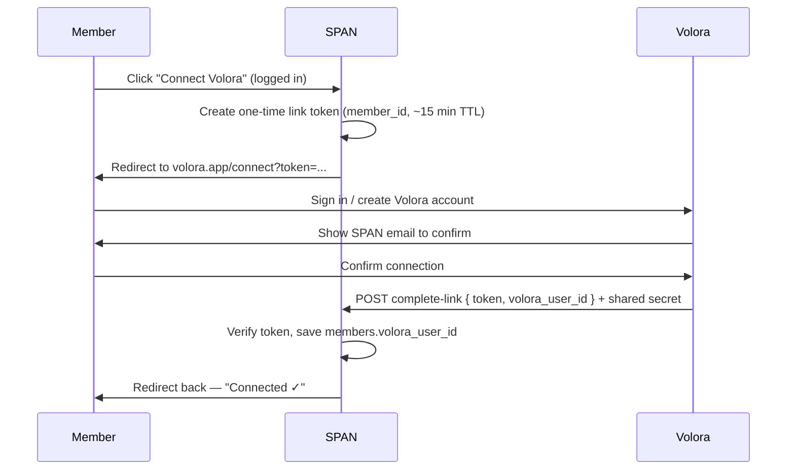

# Volora × SPAN integration (reference)

**Status:** Conceptual only — not implemented in this repo.  
**Audience:** Maintainers, Joel, Hriday (Volora), and AI assistants working on SPAN.  
**Last discussed:** July 2026.

---

## Summary

[Volora](https://volora.base44.app/) (made by Hriday) is a volunteer-hours product with a nicer logging UX (goals, categories, progress). SPAN already has a full volunteer system: members log hours in the dashboard, execs approve/deny, and official verification letters are generated in SPAN (`generateVolunteerPDF.js` + `send-volunteer-verification` Edge Function).

**Recommended model:** Volora is the **logging front-end**; SPAN remains the **system of record** for approval and official verification.

| Concern | Owner |
| --- | --- |
| Log hours (UX, goals, categories) | Volora |
| Pending → approved/denied workflow | SPAN (unchanged) |
| Official verification PDF / email | SPAN only |
| Account linking (who is who) | Both (one-time connect) |
| Which hours sync to SPAN | Volora filter (org or goal = SPAN) |

Do **not** replace SPAN’s volunteer table or exec approval with Volora’s internal approval state for chapter purposes.

---

## Current SPAN volunteer system

### Database

**`volunteers`** (`supabase/migrations/full_db_schema_for_ref.sql`):

| Column | Notes |
| --- | --- |
| `id` | bigint identity PK |
| `member_id` | FK → `members.member_id` |
| `start_timestamp`, `end_timestamp` | Duration (or derived hours) |
| `volunteering_job_title`, `volunteering_job_desc` | Activity label + description |
| `request_submit_timestamp` | When submitted |
| `approved` | `'waiting'` \| `'approved'` \| `'denied'` |
| `supervisor_comment` | Optional exec comment |
| `reviewed_by`, `reviewed_at` | Added in `volunteers_add_reviewed_by.sql` |

**Not present today (would be needed for integration):**

- `members.volora_user_id` — link to Volora account
- `volunteers.volora_entry_id` — idempotency / dedupe on webhook replay
- `volunteers.source` — e.g. `'span'` \| `'volora'` (optional, for UI badge)
- `volunteers.category` — if we want to display Volora category in SPAN

### UI / code

- **Member logging:** `VolunteerHoursSection.jsx` + handlers in `DashboardPage.jsx` (“Add Entry”).
- **Exec actions:** Approve, deny, comment, delete (exec policies in `volunteers_exec_delete_policy.sql`).
- **Verification:** `src/lib/generateVolunteerPDF.js`; email via `supabase/functions/send-volunteer-verification/`.
- **Permissions:** `members.volunteer` boolean; exec = all four permission flags.

---

## End-to-end flow (5 steps)

```
Connect → Log in Volora → Webhook → SPAN pending → Exec approves → Verification PDF
```

An interactive Cursor canvas mockup exists locally (not in git):  
`~/.cursor/projects/Users-adityabakshi-Downloads-GitHub-span/canvases/volora-span-integration.canvas.tsx`

---

## Step 1: Connect (account linking)

**Purpose:** Map `volora_user_id` ↔ SPAN `member_id` so webhooks know where to insert rows.

### What gets stored

```sql
-- Proposed migration (not written yet)
ALTER TABLE public.members
  ADD COLUMN volora_user_id text UNIQUE;

COMMENT ON COLUMN public.members.volora_user_id IS
  'Volora user id after one-time account link; NULL = not connected.';
```

### Sequence



### SPAN-side build

1. **UI** — In Volunteer Hours (`VolunteerHoursSection.jsx`): card showing connection status + “Connect Volora” / “Disconnect”.
2. **Issue token** — Edge Function (authenticated): `{ member_id }` → signed/expiring token stored briefly (DB or JWT).
3. **Complete link** — Edge Function (server-to-server from Volora): validate token + shared secret → set `volora_user_id`.
4. **Redirect URL** — Back to SPAN dashboard volunteer section after success.

### Volora-side build (Hriday)

1. `/connect` page accepting SPAN `token` query param.
2. Server call to SPAN to complete link with `volora_user_id`.
3. Settings UI: “Connected to SPAN as {email}” + disconnect (clears mapping on both sides).

### Security notes

- **Token, not raw member_id in URL** — prevents linking someone else’s SPAN account.
- **SPAN email is the trust anchor** — member’s `members.email` (e.g. `first.last@spanationwide.org`).
- **Shared secret** on Volora → SPAN complete-link endpoint.
- **Disconnect** — set `volora_user_id = NULL`; future webhooks for that Volora user are rejected or queued.

### Simpler fallback

**6-digit pairing code:** SPAN shows code; member enters in Volora; Volora confirms with SPAN. Same data model, worse UX, easier on low-code stacks (e.g. Base44).

---

## Step 2: Log hours in Volora

Member uses Volora’s UI (date, hours, description, supervisor, goals/categories).

**SPAN does not need a duplicate form** for connected members (optional: keep “Add Entry” as fallback).

### SPAN org / goal requirement

Linked account alone is **not enough**. Only entries tagged as **SPAN chapter hours** should webhook to SPAN.

If Volora is multi-org or tracks non-SPAN volunteering, unfiltered sync would import personal/school hours into SPAN’s exec queue.

**Filter options (pick one primary rule on Volora):**

| Approach | Webhook rule | Notes |
| --- | --- | --- |
| **A. Organization = SPAN** | `organization === "SPAN"` | Cleanest if Joel enables orgs |
| **B. SPAN goal namespace** | goal/category under SPAN (e.g. “SPAN — Healthcare”) | Good for progress bars |
| **C. Per-entry toggle** | `submit_to_span === true` | Explicit; more friction |

**Recommendation:** **A or B**, with **default org = SPAN** when user arrived via Connect from SPAN.

### Field mapping (Volora → SPAN)

| Volora (example) | SPAN `volunteers` |
| --- | --- |
| `date` + `hours` | `start_timestamp` / `end_timestamp` (or fixed duration) |
| `description` | `volunteering_job_desc` |
| `category` or org name | `volunteering_job_title` and/or new `category` column |
| `supervisor` | Could map to comment or future supervisor field |
| — | `approved = 'waiting'` always on import |
| `volora_entry_id` | Stored for dedupe |

---

## Step 3: Webhook (Volora → SPAN)

Volora sends server-to-server POST when a qualifying entry is created (and optionally updated/deleted).

### Example payload

```json
{
  "event": "entry.created",
  "volora_entry_id": "ent_9f3a2b",
  "volora_user_id": "usr_adibak",
  "organization": "SPAN",
  "date": "2026-07-09",
  "hours": 3,
  "category": "Healthcare",
  "description": "Health fair tabling",
  "status": "pending"
}
```

(`status` on Volora side is informational; SPAN always creates `approved = 'waiting'`.)

### SPAN handler logic (pseudocode)

```
POST /functions/v1/volora-webhook
  verify signature / shared secret

  IF event != "entry.created" → 200 ignore (or handle updates later)

  member = SELECT * FROM members WHERE volora_user_id = payload.volora_user_id
  IF NOT member → 404 or 200 log "unknown user"

  IF payload.organization != "SPAN" AND NOT is_span_goal(payload.category):
    → 200 ignore (not chapter hours)

  IF EXISTS volunteers WHERE volora_entry_id = payload.volora_entry_id:
    → 200 already imported (idempotent)

  INSERT volunteers (
    member_id, start/end, title, desc,
    approved = 'waiting',
    volora_entry_id, source = 'volora'
  )
```

### SPAN-side build

- Edge Function `volora-webhook` with HMAC or bearer secret.
- Migration for `volora_entry_id` (+ optional `source`, `category`).
- Logging for failed lookups / rejected org filter.

### Volora-side build

- Outbound webhook on entry create (SPAN-filtered).
- Retry policy; treat duplicate `volora_entry_id` as success if SPAN returns 200.

---

## Step 4: SPAN pending (exec review)

Imported from webhook appears in dashboard like any other submission:

- Filter: **Pending** tab in `VolunteerHoursSection.jsx`.
- Optional UI: badge **“via Volora”** when `source = 'volora'`.
- Execs: approve / deny / comment — **same handlers as today**.

Members should **not** be able to edit Volora-imported rows in SPAN (or edits must sync back to Volora — out of scope for v1; deny + re-log in Volora is simpler).

---

## Step 5: Exec approves → verification

**Unchanged from current product:**

1. Exec approves entry → `approved = 'approved'`, `reviewed_by`, `reviewed_at`.
2. Member or exec generates PDF via `generateVolunteerPDF.js`.
3. Email via `send-volunteer-verification` (exec-only).

Official chapter letters come **only** from SPAN-approved rows, not Volora’s internal status.

---

## Division of work

### SPAN (this repo)

| Item | Effort |
| --- | --- |
| Migration: `members.volora_user_id`, `volunteers.volora_entry_id` | Small |
| Connect UI + issue/complete link Edge Functions | Medium |
| `volora-webhook` Edge Function | Medium |
| “via Volora” badge, disable edit on imported rows | Small |
| Docs + Joel deploy | Small |

### Volora (Hriday / Joel)

| Item | Notes |
| --- | --- |
| Connect landing + callback to SPAN | Base44 backend function + `/connect` page (see below) |
| Webhook on entry create | Data-event automation → `fetch()` to SPAN; filter org/goal = SPAN |
| Default SPAN org for linked users | UX polish |
| Org field vs goals-only product decision | Affects filter rule |
| `WebhookLog` entity + retry on failure | Recommended; Base44 does not auto-retry outbound calls |

---

## Base44 feasibility (Volora platform)

Volora runs on [Base44](https://volora.base44.app/) ([docs index](https://docs.base44.com/llms.txt)). **Integration is feasible** — there is no one-click “webhook URL” setting, but Base44 supports the required patterns via **backend functions** and **data-event automations**.

### What Base44 supports

| Integration piece | Supported? | How |
| --- | --- | --- |
| Outbound POST to SPAN when hours logged | Yes | [Backend function](https://docs.base44.com/developers/backend/resources/backend-functions/overview) with `fetch()` + secret in env |
| Trigger on new volunteer entry | Yes | [Data event automation](https://docs.base44.com/Building-your-app/Creating-automations) on entity `create` |
| Filter org/goal = SPAN | Yes | Logic inside the function (not a platform-level filter) |
| Store link state (`span_email`, linked flag) | Yes | Custom entity fields or [User schema extension](https://docs.base44.com/developers/backend/resources/entities/user-schema) |
| Connect page (`/connect?token=...`) | Yes | Normal app page + function invoked from frontend |
| Receive POST from SPAN (complete link) | Yes | Public HTTP endpoint per function: `https://<app-domain>/functions/<function-name>` |
| Secrets (shared HMAC with SPAN) | Yes | Env vars / `secrets set` in backend functions |
| Native outbound webhooks UI | No | Must be implemented in backend code |
| SPAN listed as a connector | No | [Custom third-party API](https://docs.base44.com/developers/references/sdk/getting-started/third-party-apis) only |

### Recommended Volora build (Hriday)

Does **not** require the full Developer Platform CLI — the app-editor AI chat can create automations and backend functions on **Builder plan or higher**.

1. **User fields** — e.g. `span_linked`, `span_email` (and optional stored token during connect).
2. **Page `/connect`** — reads `token` from query string, shows SPAN email, member confirms.
3. **Backend function `completeSpanLink`** — POST to SPAN `volora-complete-link` with `{ token, volora_user_id }` + shared secret.
4. **Data event automation** — on `VolunteerEntry` (or equivalent entity) **create**:
   - if `organization === "SPAN"` (or SPAN goal/category) **and** user is linked → POST to SPAN `volora-webhook`.
   - never call SPAN from the browser (same pattern as [Zapier integration](https://docs.base44.com/Integrations/Zapier-integration)).
5. **`WebhookLog` entity** — log failures; optional manual or scheduled retry (Base44 does not auto-retry failed outbound `fetch()`).

Example automation prompt for Hriday:

```text
When a volunteer entry is created, if organization is SPAN and the user has linked
their SPAN account, POST the entry to an external API from a backend function only.
Never call the external API from the browser. Store a shared secret securely.
```

### Platform constraints

| Constraint | Detail |
| --- | --- |
| Plan | **Builder+** required for [automations](https://docs.base44.com/Building-your-app/Creating-automations) |
| Credits | **1 integration credit per automation run** (each hour log ≈ one run) |
| Run timeout | **3 minutes max** per run ( ample for a single webhook) |
| Entity events | Fire only on **single-record** create/update/delete — not bulk or `updateMany()` ([automations ref](https://docs.base44.com/developers/backend/resources/backend-functions/automations)) |
| Auth | Volora login is separate from SPAN (Supabase); connect-by-token is correct — no shared SSO session |
| Function limit | **50 backend functions** per project |

### Risks and workarounds

1. **`/functions/*` routing** — Community reports some function URLs can **405** if the path collides with a frontend route ([webhooks guide](https://www.base44devs.com/blog/base44-webhooks-complete-guide)). Use distinct names (e.g. `api-span-webhook`, not `connect`).
2. **Idempotency** — SPAN must dedupe on `volora_entry_id`; Volora should log delivery status locally.
3. **AI-generated code** — Review connect + webhook functions; test with real SPAN staging endpoints.
4. **Zapier middleman** — Possible (Volora → Zapier → SPAN) but adds cost/latency; direct `fetch()` to SPAN Edge Functions is preferred.

### Mockup reference

Interactive stakeholder mockup (Claude artifact): [Volora × SPAN Integration Mockup](https://claude.ai/public/artifacts/34b13e8a-fc31-47a3-a21f-5a3130e13165)

---

## Open questions for Joel / Hriday

1. **Orgs vs goals only** — Is `organization: "SPAN"` available, or only category/goals?
2. **Webhook implementation** — Hriday to add data-event automation + backend function (Base44 supports this; see above). Confirm Builder plan and credit budget.
3. **Updates/deletes** — If member edits hours in Volora after sync, update SPAN row or require new entry?
4. **Supervisor field** — Does Volora capture supervisor email? Map to SPAN how?
5. **Multi-chapter** — Is Volora national-only for SPAN Nationwide, or per-state chapters later?
6. **Disconnect** — What happens to already-imported pending rows?

---

## Product positioning (for stakeholders)

- **Positive:** Volora improves logging UX; SPAN keeps governance and official PDFs.
- **Not a replacement:** Exec approval and verification stay in SPAN.
- **Integration cost:** Real engineering on both sides; not a config toggle.
- **Alternative:** SPAN could add goals/categories natively and skip Volora if overlap is too high.

---

## Related SPAN docs

- [DASHBOARD_FUNCTIONS.md](./DASHBOARD_FUNCTIONS.md) — Volunteer Hours section
- [COPILOT_CONTEXT.md](./COPILOT_CONTEXT.md) — Volunteer PDF + verification API
- [DATABASE_ARCHITECTURE.md](./DATABASE_ARCHITECTURE.md) — Tables overview

---

## Changelog

| Date | Change |
| --- | --- |
| 2026-07-09 | Added Base44 feasibility section, platform constraints, and Claude mockup link |
| 2026-07-09 | Initial reference doc from integration design discussion + canvas mockup |
